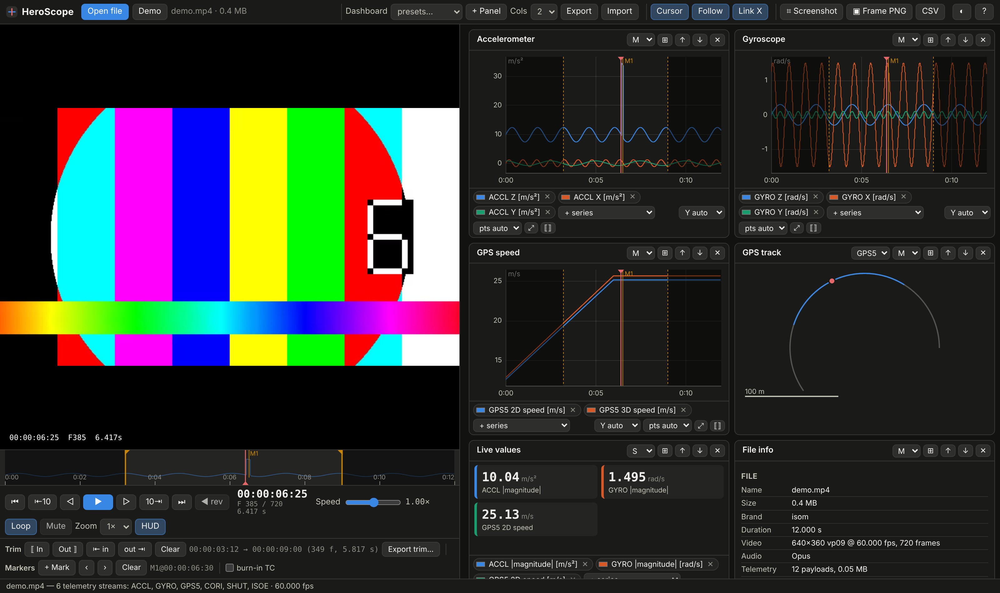

# HeroScope

**A static, in‑browser viewer for GoPro video + GPMF telemetry.**
Open a GoPro `.MP4`, watch it with frame‑accurate controls, and graph the sensor data
embedded in the file (accelerometer, gyroscope, GPS, orientation, exposure, …) on a
dashboard you configure yourself. Nothing is uploaded, nothing is installed: it is one
HTML page and three scripts.



## Features

**Video / high‑speed viewer transport**
- Frame‑accurate stepping (±1, ±10), timecode `HH:MM:SS:FF`, frame counter and seconds.
- Speed 0.1× – 8× (log slider, ↑/↓ keys), reverse play, J/K/L shuttle, loop.
- Picture zoom up to 8× (wheel over the video, drag to pan), timecode HUD overlay.
- Timeline with an accelerometer‑magnitude strip, draggable in/out handles, markers.

**Virtual trim**
- Set in/out points (I / O); playback loops inside them; charts and the GPS track dim the rest.
- Export the trim as JSON (frames, seconds, timecodes, markers) or copy a ready
  `ffmpeg` command (stream copy that keeps the GPMF track, or a frame‑exact re‑encode).
- CSV export can be limited to the trimmed range.

**Telemetry graphs**
- Reads the `gpmd` track straight from the MP4 (no ffmpeg, no server) using `File.slice`,
  so multi‑GB files load without being read into memory.
- Decodes the GPMF KLV tree: SCAL scaling, SIUN/UNIT units, ORIN axis labels, complex
  `TYPE` structures, multi‑device DEVC blocks, per‑payload attributes (GPSU, GPSF, GPSP, TMPC…).
- Any number of charts; overlay any streams on one chart (mixed units switch to a
  normalized axis automatically), or show streams side by side.
- Min/max decimation keeps 200 Hz × hours of data smooth; wheel to zoom, drag to pan,
  click to seek the video, double‑click to reset; linked or independent time axes.
- **Cursor line** (toggle with **C**) shows where the current video frame sits on every graph;
  **Follow** scrolls graphs during playback.
- Hover crosshair lists the value of every series at that time.

**Configurable dashboard**
- Panel types: *Chart*, *Values* (live readout tiles), *Track* (GPS path with playhead), *Info*.
- Presets (Default, Motion, GPS, Camera, Every stream, Blank), 1–4 columns, panel
  height, full‑width toggle, reorder, per‑series colors.
- Layout is remembered in the browser and can be exported/imported as JSON.

**Capture**
- **Screenshot** (S): a PNG of the whole interface, composed from the live video frame,
  every chart canvas and the UI text. Shift+S / Shift+click uses the browser's exact
  screen‑capture instead.
- **Frame PNG** (F): the current frame at the video's native resolution, optionally with
  burned‑in timecode.

## Use it

Serve or open the folder — no build step:

```sh
# any static server works, e.g.
python3 -m http.server 8000      # then open http://localhost:8000/
```

Opening `index.html` directly from disk also works (the bundled *Demo* button needs http).
The repo is private and not deployed anywhere; serve it locally as above.
Drop a GoPro file onto the video area or click **Open file**.

> **Codecs.** The browser decodes the video, so H.264 GoPro files play everywhere;
> HEVC (H.265, "HEVC" setting on HERO6+) plays only where the browser has hardware
> HEVC support (Safari, Edge, Chrome on supported machines). Telemetry still loads
> either way. To transcode and keep the GPMF track:
> `ffmpeg -i in.MP4 -map 0 -c copy -c:v libx264 -crf 18 out.mp4`

### Keyboard

| Key | Action | Key | Action |
|---|---|---|---|
| Space | Play / pause | I / O | Set in / out |
| J / K / L | Reverse / pause / forward | Shift+I / O | Jump to in / out |
| ← / → | ±1 frame | M | Add marker |
| Shift+← / → | ±10 frames | , / . | Previous / next marker |
| Home / End | Start / end of trim | C | Toggle cursor line |
| ↑ / ↓ | Faster / slower | F | Frame PNG |
| Ctrl+O | Open file | S | Screenshot |

## How timing works

Each `gpmd` sample (normally one per second) is stamped with the MP4 sample table
(`stts`/edit list). Samples inside a payload are spread evenly across the payload's
span, which is how GoPro's own reference tools place them when no per‑sample
timestamps exist. Frame numbers come from the video track's `stts` (dominant frame
duration), so 29.97/59.94/239.76 fps files count correctly.

## Project layout

```
index.html        UI shell
css/style.css     theme (dark default, light via toggle/OS)
js/mp4.js         ISO BMFF reader: moov tree, sample tables, gpmd/udta extraction
js/gpmf.js        GPMF KLV parser → typed streams
js/plot.js        canvas time‑series chart (decimation, zoom/pan, cursor, tooltip)
js/app.js         transport, timeline, dashboard, trim, capture, exports
fixtures/demo.mp4 12 s test clip with a synthetic GPMF track (VP9, so it plays in Chromium)
tools/make-fixture.js  rebuilds the fixture (needs ffmpeg)
tests/            node:test unit tests + Playwright end‑to‑end smoke test
.github/workflows CI (unit + e2e tests)
```

## Development

```sh
npm test            # parser unit tests (node --test)
npm run e2e         # Playwright smoke test (needs `npx playwright install chromium`)
npm run fixture     # regenerate fixtures/demo.mp4 (needs ffmpeg)
```

No dependencies at runtime. Browser support: current Chrome/Edge/Firefox/Safari
(`requestVideoFrameCallback` is used for frame‑exact readouts where available).

## Acknowledgements

GPMF format: [gopro/gpmf-parser](https://github.com/gopro/gpmf-parser). Sample streams
and semantics follow that documentation. HeroScope is not affiliated with GoPro.

## License

MIT — see [LICENSE](LICENSE).
